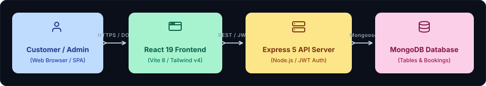

<div align="center">


<br/>

<a href="#system-architecture">
  
</a>
&nbsp;
<a href="#system-architecture">
  
</a>
&nbsp;
<a href="#system-architecture">
  
</a>
&nbsp;
<a href="#system-architecture">
  
</a>

</div>

<br/>

# Vindela — Full-Stack Culinary Commerce Platform

A modern, production-grade Restaurant Reservation and Table Capacity Management System built with React 19, Express 5, and MongoDB.

This application unifies customer-facing table reservations with an administrative operations center to oversee real-time table occupancies, bookings, and restaurant capacity.

---

## System Architecture

<p align="center" style="margin: 20px 0;">
  
</p>

* **Customer / Admin**: Browser client interacting with the React 19 single-page application.
* **React 19 Frontend**: Built with Vite 8, Tailwind CSS v4, Lucide icons, and Axios API services.
* **Express 5 API Server**: Node.js REST gateway managing JWT authentication, role guards, and reservation validation.
* **MongoDB Database**: Document-oriented collections (`User`, `Table`, `Reservation`) managed with Mongoose 9 schemas.

---

## Engineering Documentation

The project includes a complete production-grade architecture and development documentation suite:

| Document | Purpose |
| :-- | :-- |
| [**`docs/PRD.md`**](./docs/PRD.md) | Product Requirements Document: MVP specifications, target personas & success metrics |
| [**`docs/ARCHITECTURE.md`**](./docs/ARCHITECTURE.md) | System topology, availability engine logic, directory tree & ADRs |
| [**`docs/RULES.md`**](./docs/RULES.md) | Engineering standards, React 19/Express conventions, and booking integrity rules |
| [**`docs/DESIGN.md`**](./docs/DESIGN.md) | Design system, UI tokens, Inter & JetBrains Mono typography, and telemetry cards |
| [**`docs/TASKS.md`**](./docs/TASKS.md) | Phased roadmap tracking 24 engineering deliverables with priority & status badges |
| [**`docs/MEMORY.md`**](./docs/MEMORY.md) | Active session memory, completed milestone log, and operational boundaries |

---

## Setup Instructions

### Prerequisites
- Node.js (`v18+`)
- MongoDB (Atlas or Local instance)

### 1. Clone the repository
```bash
git clone https://github.com/abhishek4643/Vindela.git
cd Vindela
```

### 2. Backend Setup
```bash
cd backend
npm install
```
Create a `.env` file in the `backend` directory with the following variables:
```env
PORT=5000
MONGO_URI=your_mongodb_connection_string
JWT_SECRET=your_jwt_secret
JWT_EXPIRE=7d
NODE_ENV=development
FRONTEND_URL=http://localhost:5173
```
Run the database seed script to populate tables and create the default admin user:
```bash
npm run seed
```
Start the backend server:
```bash
npm run dev
```

### 3. Frontend Setup
Open a new terminal window:
```bash
cd frontend
npm install
```
Start the frontend development server:
```bash
npm run dev
```

### 4. Default Credentials
- **Admin**: `admin@restaurant.com` / `Admin@123`
- **Customer**: Register a new account on the login page.

---

## Reservation & Availability Logic

The core availability engine ensures that overlapping reservations and capacity conflicts are mathematically impossible.

**Logic Flow:**
1. **Capacity Filtering**: When a customer searches for a date and guest count, the backend filters tables where `table.capacity >= guestCount`.
2. **Conflict Checking**: For matching tables, the system queries the `Reservation` collection for existing `confirmed` or `pending` bookings on that date.
3. **Slot Availability**: Maps over fixed 2-hour slots (`VALID_TIME_SLOTS`) and removes slots that already have a booking for that specific table.
4. **Validation**: During checkout, an atomic pre-save double-check prevents concurrent booking race conditions.

---

## Role-Based Access Control (User vs Admin)

The system uses JWT (JSON Web Tokens) for authentication and a robust middleware architecture for authorization:

- **Customer (User)**: 
  - Routes: `/dashboard`, `/reserve`.
  - Can view their own reservations (filtered via `req.user.id`).
  - Can cancel their own reservations within policy windows.
- **Administrator (Admin)**: 
  - Routes: `/admin`, `/admin/reservations`, `/admin/tables`.
  - Protected via `authorize('admin')` middleware.
  - Can view all reservations, update statuses (`Confirm`, `Complete`, `Cancel`), and manage active table inventory.

---

## License

This project is open-source and available under the MIT License.
