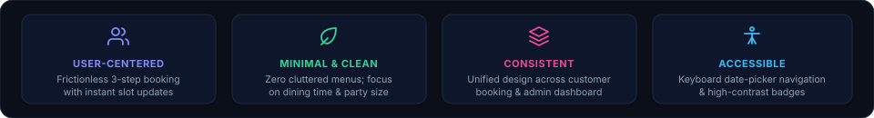
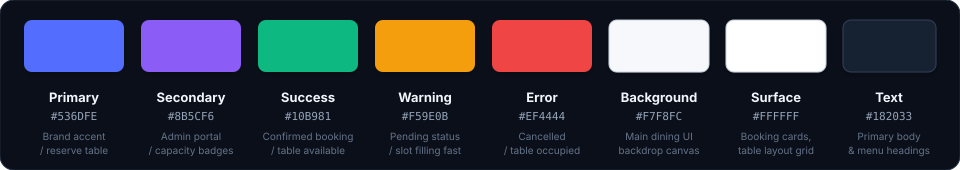

# Design System
### Vindela — Clean. Simple. Productive.

<div align="center">
  
</div>

This document defines the visual design system, UI components, design tokens, and user experience standards for the **Vindela** culinary commerce platform, customer reservation portal, and administrative command center. The goal is to establish an elegant, modern, minimal interface with consistent styling across guest-facing menus, table pickers, and admin dashboards.

---

### 1. Design Principles

<p align="center" style="margin: 20px 0;">
  
</p>

---

### 2. Color Palette
*Primary colors used across the application, table picker, and admin dashboards:*

<p align="center" style="margin: 20px 0;">
  
</p>

---

### 3. Typography
*We use Inter as the primary interface font and JetBrains Mono for reservation IDs, timestamps, and API schemas:*

<div style="background-color: #0D1117; border: 1px solid #30363D; border-radius: 8px; padding: 18px 20px; margin: 14px 0;">
  <table width="100%" cellpadding="0" cellspacing="0" border="0">
    <tr>
      <td width="90" align="center" style="font-size: 40px; font-weight: 800; background-color: #161B22; color: #818CF8; border: 1px solid #30363D; border-radius: 8px; padding: 8px 12px;">Aa</td>
      <td style="padding-left: 20px;">
        <div style="font-size: 18px; font-weight: 700; color: #F0F6FC;">Inter &amp; JetBrains Mono</div>
        <div style="color: #818CF8; font-size: 12px; font-weight: 600; margin-top: 2px;">Primary font family</div>
        <div style="color: #8B949E; font-size: 12px; margin-top: 4px;">Clean, modern, and highly readable across dining menus, booking summaries, and management tables.</div>
      </td>
    </tr>
  </table>
</div>

| Element | Font Family | Size | Weight | Line Height |
| :-- | :-- | :-: | :-: | :-: |
| **Heading 1 (H1)** | Inter | 24px (1.5rem) | 700 Bold | 1.3 |
| **Heading 2 (H2)** | Inter | 18px (1.125rem) | 600 Semi-Bold | 1.4 |
| **Heading 3 (H3)** | Inter | 14px (0.875rem) | 600 Semi-Bold | 1.4 |
| **Body Text** | Inter | 13px (0.8125rem) | 400 Regular | 1.6 |
| **Booking IDs & Times** | JetBrains Mono | 12px (0.75rem) | 400 Regular / 600 Bold | 1.6 |
| **Status Badges & Pills** | Inter | 11px (0.6875rem) | 600 Semi-Bold | 1.2 |

---

### 4. UI Components
*Standard components matching Abhishek's profile design standards:*

#### Buttons
<div style="margin: 12px 0;">
  <a href="#" style="background-color: #4F46E5; color: #FFFFFF; border-radius: 6px; padding: 8px 18px; font-size: 12px; font-weight: 600; text-decoration: none; display: inline-block; margin-right: 8px;">Confirm Reservation</a>
  <a href="#" style="background-color: #161B22; color: #C9D1D9; border: 1px solid #30363D; border-radius: 6px; padding: 8px 18px; font-size: 12px; font-weight: 600; text-decoration: none; display: inline-block; margin-right: 8px;">View Seating Chart</a>
  <a href="#" style="background-color: #EA4335; color: #FFFFFF; border-radius: 6px; padding: 8px 18px; font-size: 12px; font-weight: 600; text-decoration: none; display: inline-block;">Cancel Booking</a>
</div>

#### Status Badges (Shields & Pills)
<div style="margin: 12px 0;">
  
  &nbsp;
  
  &nbsp;
  
  &nbsp;
  
</div>

#### Reservation Telemetry Card
```text
+---------------------------------------------------------------------------------+
|  Vindela Reservation Operations Telemetry                     [ CONFIRMED ]     |
+---------------------------------------------------------------------------------+
|  Booking Reference: VDL-2026-9481                                               |
|  Diner: Abhishek Perumalla            Party Size: 4 Guests                      |
|  Table: #07 (Patio Booth)             Capacity: 4 Seats                         |
|  Dining Window: 19:00 - 21:00 (Dinner Service)                                  |
|  Date: 2026-11-14                     Deposit / Status: Verified                |
|                                                                                 |
|  >>> Availability Engine Verdict:                                               |
|  [OK] Party Size (4) <= Table Capacity (4)                                      |
|  [OK] Time Slot (19:00 - 21:00) Free of Overlapping Bookings                    |
|  [OK] Atomic Pre-Flight In-Memory Lock Verified                                 |
|  [OK] Confirmation Notification Dispatched via Toast & Email                    |
+---------------------------------------------------------------------------------+
```